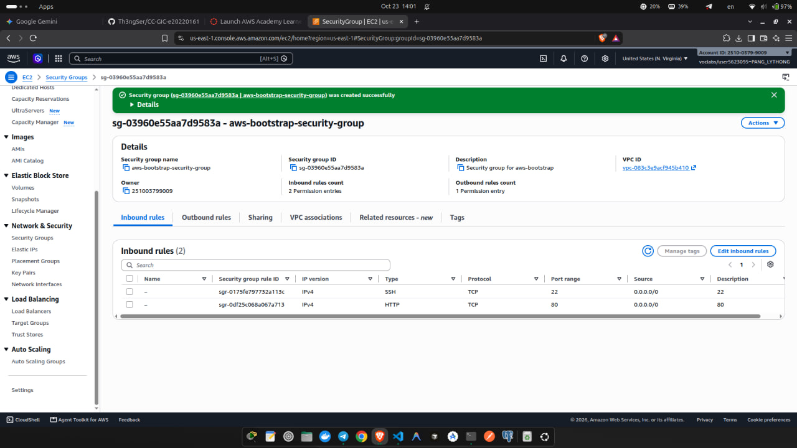
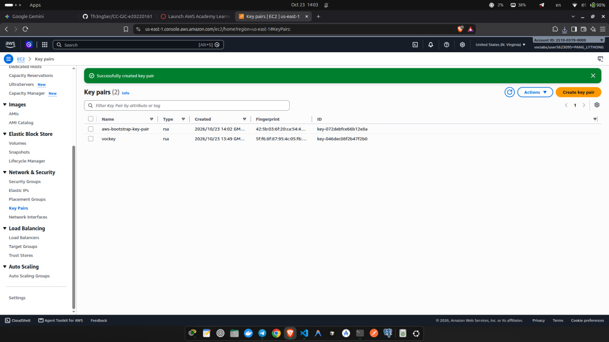
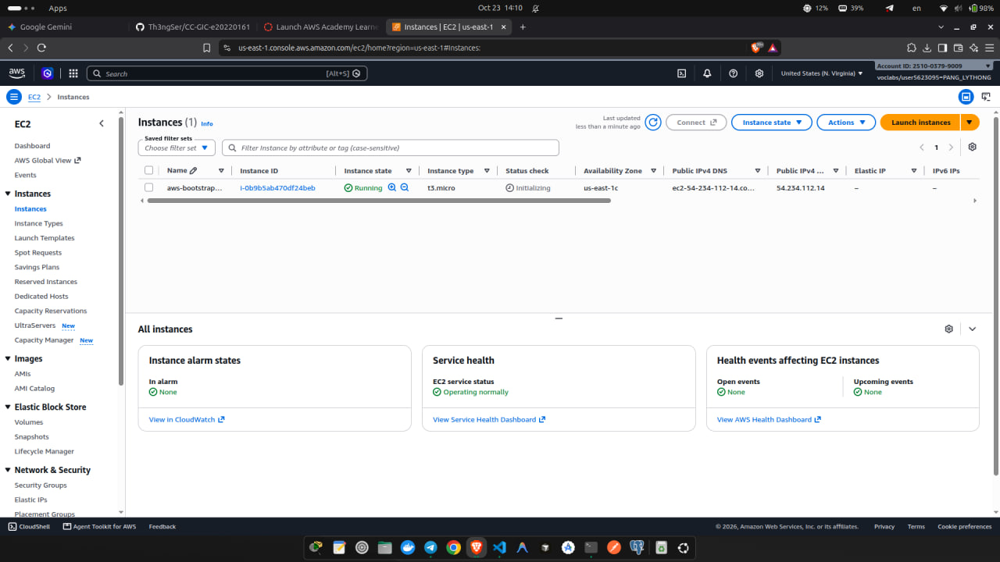
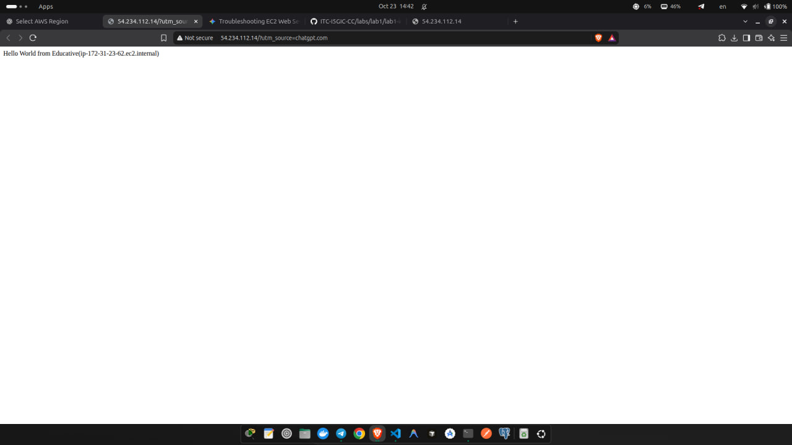
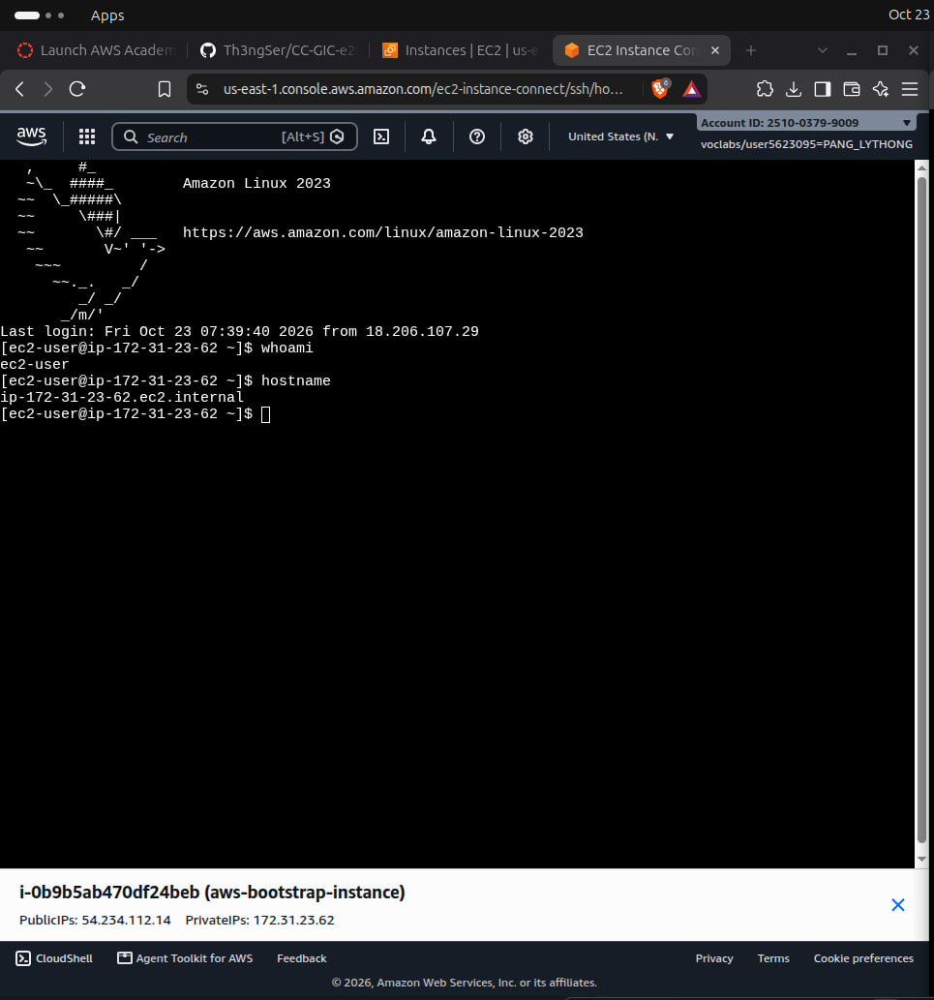
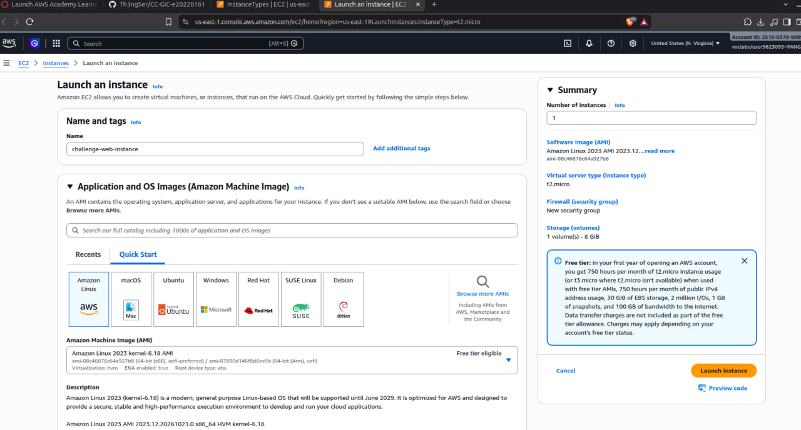
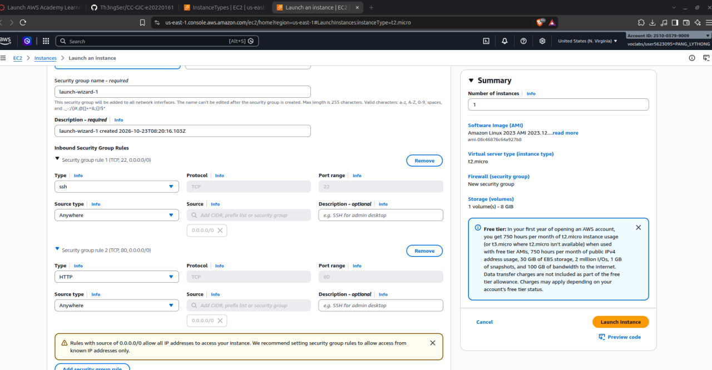
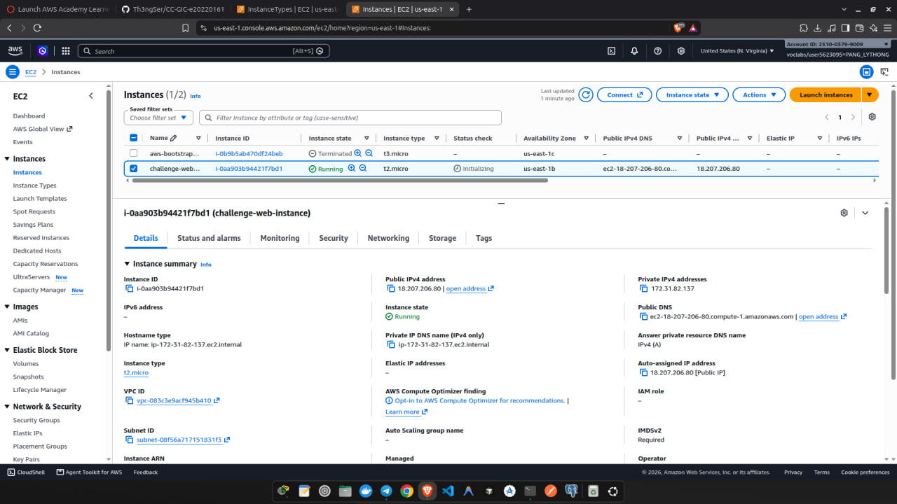
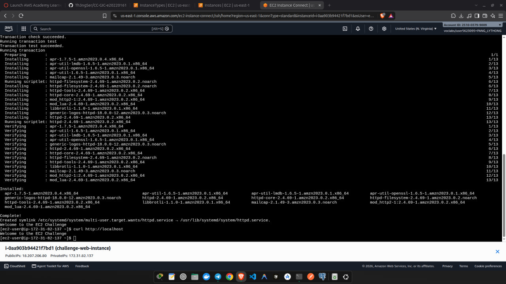
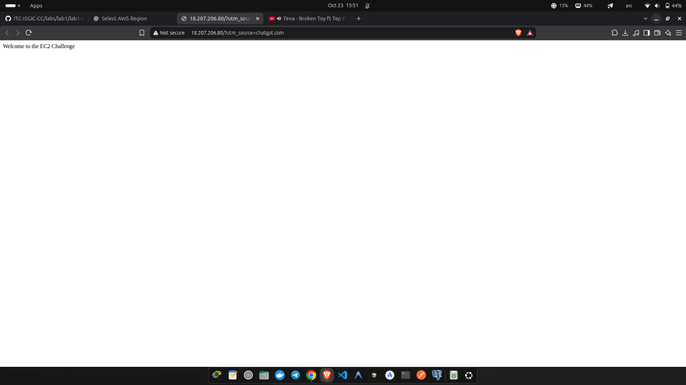

# Cloud Lab 1: Amazon EC2

## Student Information

- **Name:** PANG Lythong
- **Class:** GIC I5-B
- **Student ID:** e20220161
- **Course:** Cloud Computing
- **Lab:** Amazon EC2

## Lab Summary

In this lab, I used AWS Academy Learner Lab to create and configure EC2 instances, set up security groups and key pairs, deploy Apache web servers, and test websites using public IP addresses.

## Submission

The submission includes:
- `README.md`: Lab information and results.
- `images/`: 10 screenshots showing the configurations and tests from Parts 1.1 and 1.2.

## Folder Structure

```text
CC-GIC-e20220161/
├── .gitignore
└── cc-lab-e20220161/
    └── lab1/
        ├── README.md
        └── images/
            ├── 01-security-group.png
            ├── 02-key-pair.png
            ├── 03-instance-details.png
            ├── 04-browser-test.png
            ├── 05-ssh-connection.png
            ├── 06-challenge-launch.png
            ├── 07-challenge-security-group.png
            ├── 08-challenge-instance.png
            ├── 09-challenge-terminal.png
            └── 10-challenge-browser.png
```

## Questions and Answers

### 1. Your security group has an SSH rule and an HTTP rule. What does each one let you do? What would stop working if you deleted the HTTP rule?

The SSH rule allows remote administration of the instance over TCP port 22, for example by using SSH or EC2 Instance Connect. The HTTP rule allows web browsers to connect to the Apache web server over TCP port 80. If the HTTP rule were deleted, the web server could still be running, but browsers would not be able to access the website through the instance's public IP address because the security group would block inbound HTTP traffic.

### 2. In Part 1.1 you never logged in to install the web server. What installed it, and when did it run?

The EC2 **user data** script installed the Apache web server (`httpd`). EC2 passed the script to the instance when it launched, and cloud-init ran it automatically during the instance's first boot. The script updated the packages, installed `httpd`, started and enabled the service, and created the web page.

### 3. Why does the web page open with `http://` but not with `https://`?

The instance is configured to serve plain HTTP on port 80. It does not have an HTTPS listener on port 443, a TLS certificate, or an SSL/TLS web-server configuration. Therefore, `http://` works, while `https://` cannot complete the TLS connection and is blocked or refused.

### 4. Part 1.2 asked for a 10 GiB root volume. Where in the launch settings did you set it, and how can you check the size on the running instance?

I set it in the **Configure storage** section of the EC2 launch settings by changing the root device volume, usually `/dev/xvda` or `/dev/sda1`, to **10 GiB**. After launching the instance, I can check the root EBS volume size in the EC2 console under the instance's **Storage** tab. From the terminal, commands such as `lsblk` or `df -h /` also show the attached disk and root filesystem size.

## Screenshots

### 1. Security group



### 2. Key pair



### 3. Instance details



### 4. Browser test



### 5. SSH connection



### 6. Challenge launch



### 7. Challenge security group



### 8. Challenge instances



### 9. Challenge terminal



### 10. Challenge browser


