# Cloud Lab 2: Application Load Balancer and Auto Scaling

## Student Information

- **Name:** PANG Lythong
- **Class:** GIC I5-B
- **Student ID:** e20220161
- **Course:** Cloud Computing
- **Lab:** Application Load Balancer and EC2 Auto Scaling

## Lab Summary

In this lab, I created an Application Load Balancer, a target group, a launch template, and an Auto Scaling group. The load balancer distributed HTTP requests between EC2 instances and the Auto Scaling group replaced an instance whose web server failed its health check.

## Questions and Answers

### 1. Why does the page show a different host name when you refresh it?

The Application Load Balancer distributes requests between the healthy EC2 instances registered in the target group. Each instance writes its own host name in the web page, so a refresh may be forwarded to a different instance and display a different host name. The exact order is controlled by the load-balancing algorithm and is not guaranteed on every refresh.

### 2. After you stopped `httpd`, the instance was still running in EC2, but the target group marked it unhealthy. What did the health check test, and why did the instance fail it?

The target group's health check sent an HTTP request to the root path `/` on port 80 of the instance. It expected a successful HTTP response, normally status code `200`. The EC2 instance itself was still powered on, but stopping `httpd` stopped the web server, so port 80 no longer returned the expected response. After the configured failed checks, the target was marked **Unhealthy** and removed from service.

### 3. Who replaced the failed instance: the load balancer, the target group, or the Auto Scaling group? Explain the role of each one.

The **Auto Scaling group** replaced the failed instance.

- The **load balancer** receives client requests and forwards them to available targets.
- The **target group** registers the instances and performs health checks. It marks the instance unhealthy and stops sending traffic to it.
- The **Auto Scaling group** maintains the configured capacity. Because the target group is attached to it and ELB health checks are enabled, the Auto Scaling group terminates or deregisters the unhealthy instance and launches a replacement.

### 4. With desired 2, minimum 2 and maximum 3, how many instances run normally? In what situation could there be 3?

Normally, **2 instances** run because the desired capacity is 2. There can be **3 instances** when a scale-out action increases the desired capacity, such as a scaling policy or a manual change, provided that the maximum capacity of 3 is not exceeded. During a replacement, there may also be a short period when the old instance is draining while the new instance is starting.

### 5. The instances' security group allows HTTP from anywhere. How could you change it so that the instances accept HTTP only from the load balancer?

Remove the inbound HTTP rule whose source is `0.0.0.0/0` from `LaunchTemplateSecurityGroup`. Add an inbound rule for TCP port 80 whose source is the **security group ID of `LoadBalancerSecurityGroup`**. This allows the load balancer to reach the instances while blocking direct HTTP access from other sources. Any SSH rule should also be restricted to the administrator's trusted IP address or removed when it is not needed.

## Screenshots

The following screenshots were taken during the lab:

### 1. Load balancer security group

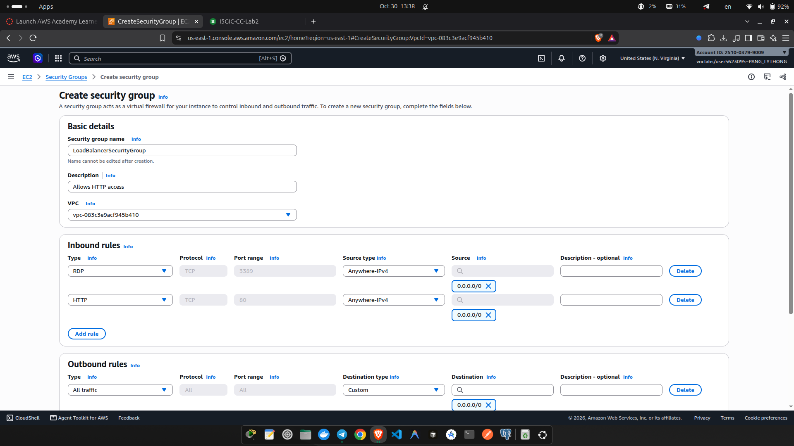

### 2. Launch template security group

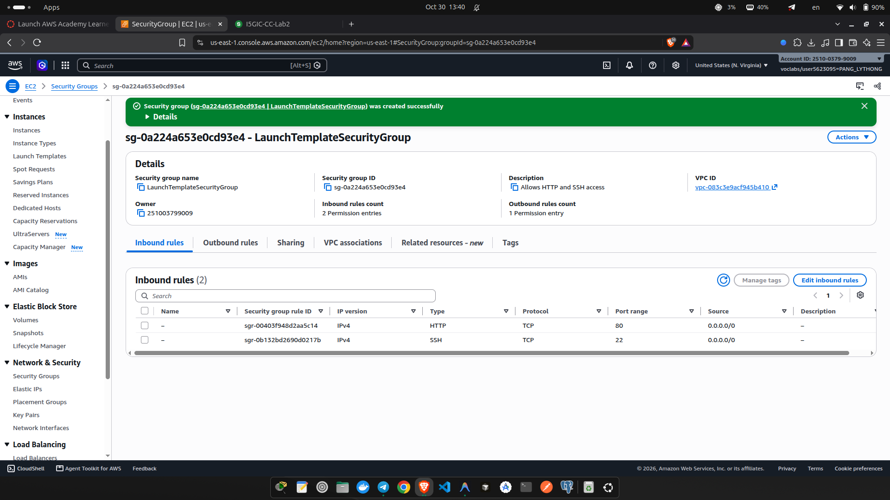

### 3. Target group

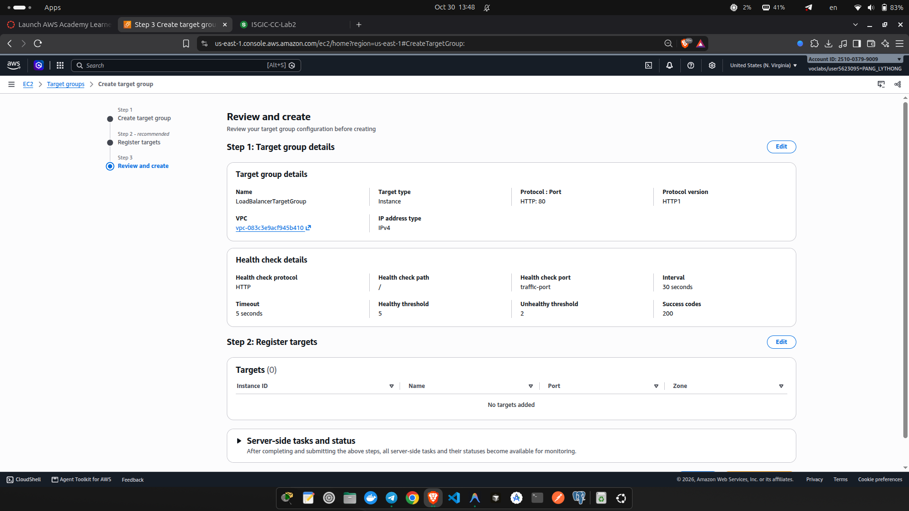

### 4. Health checks

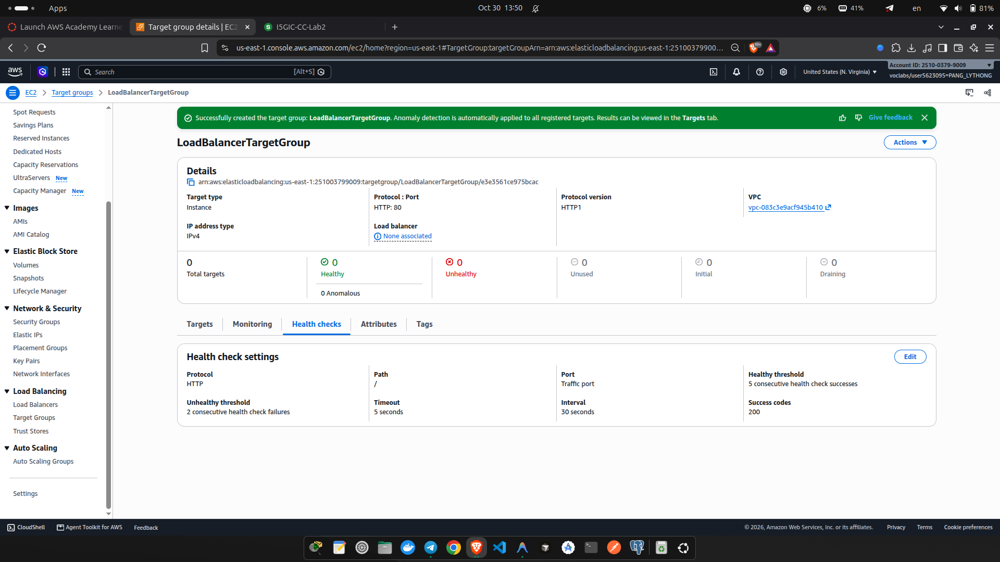

### 5. Load balancer list

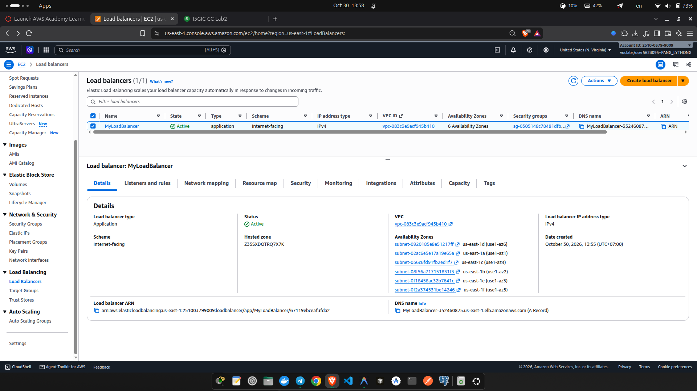

### 6. Load balancer details

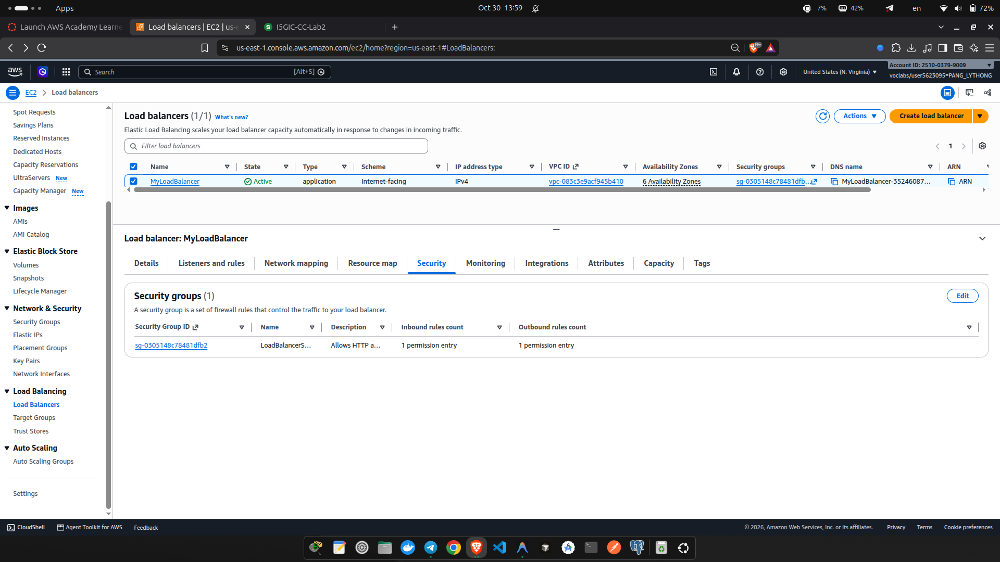

### 7. Launch template

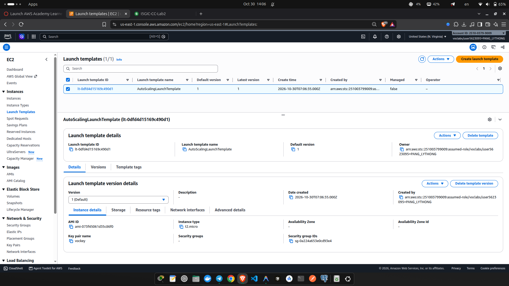

### 8. Auto Scaling group list

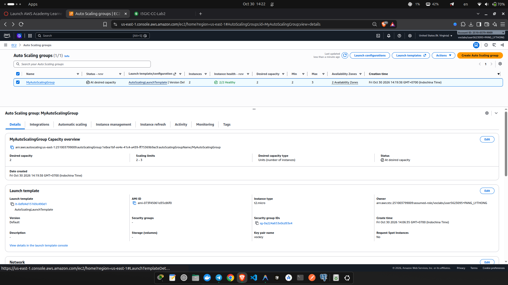

### 9. Auto Scaling group details

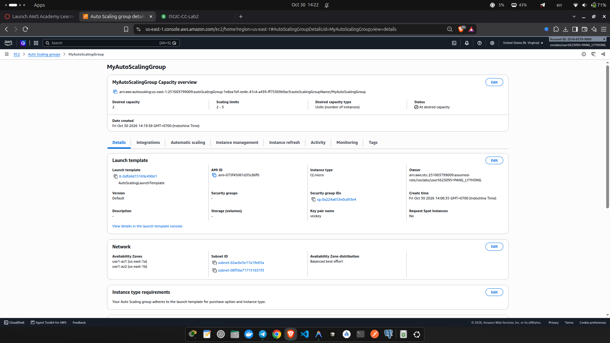

### 10. Browser test 1

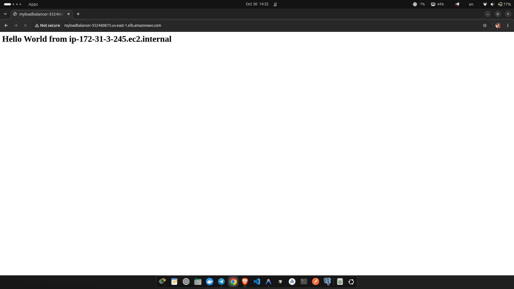

### 11. Browser test 2

### 12. Stopping HTTPD

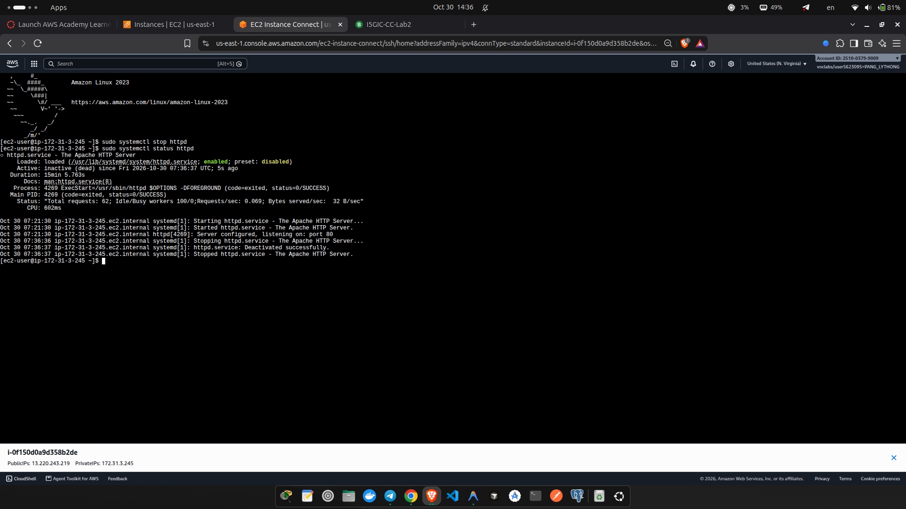

### 13. Unhealthy target

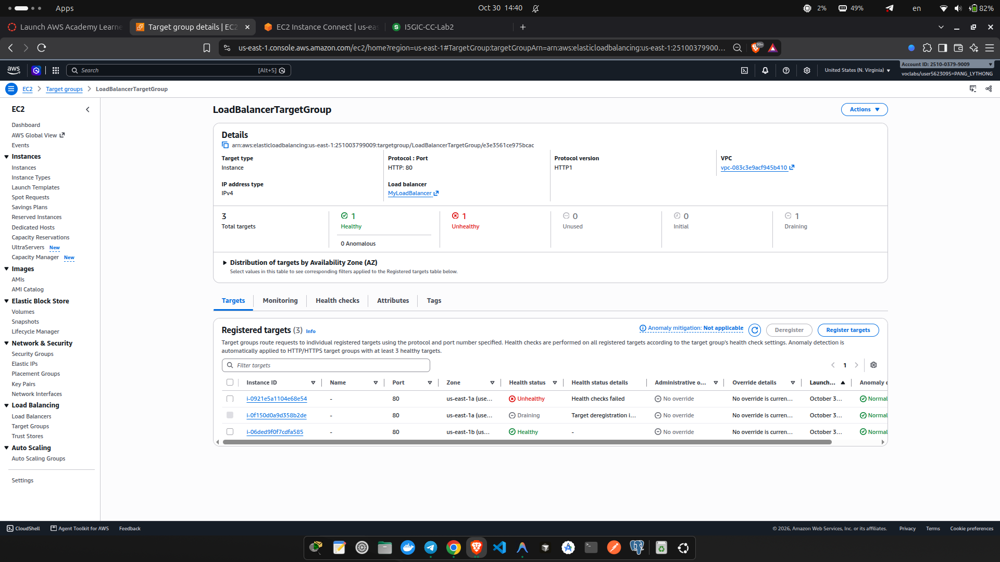

### 14. Replaced target

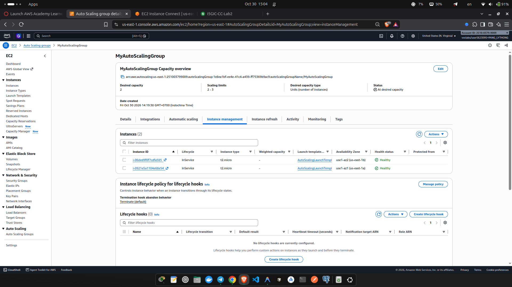

