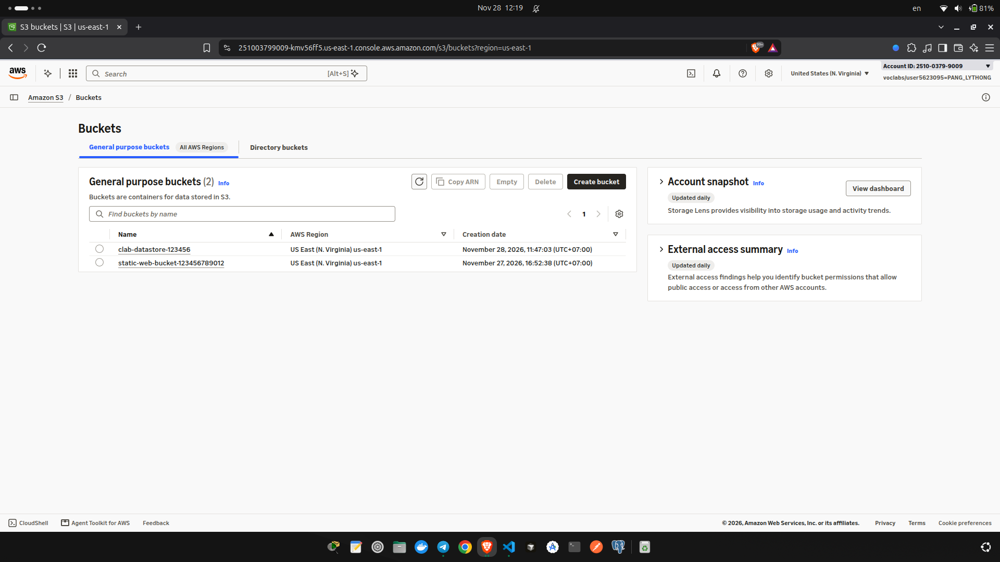
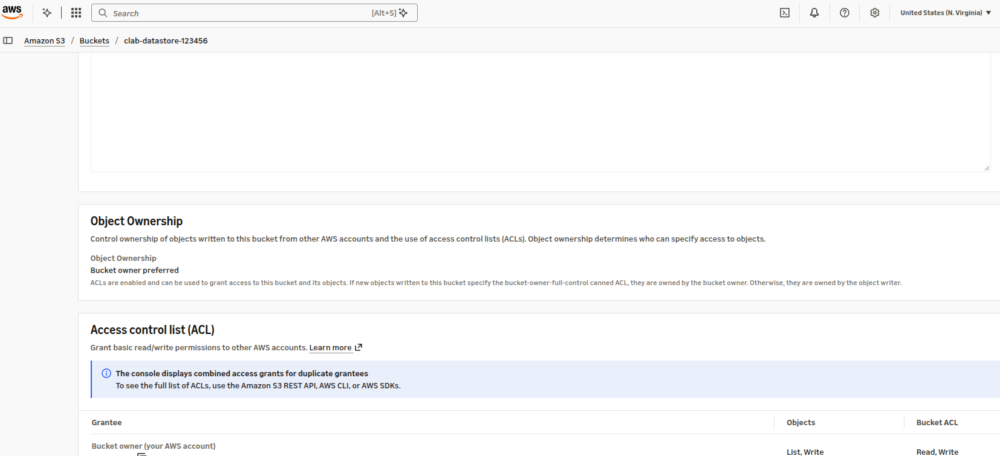
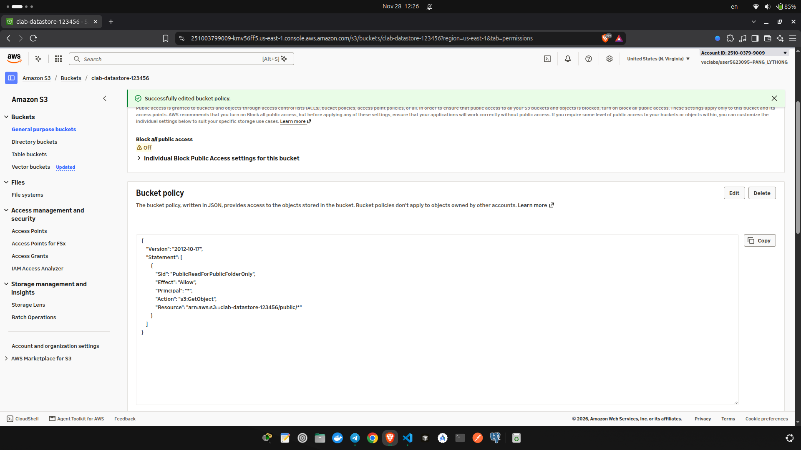
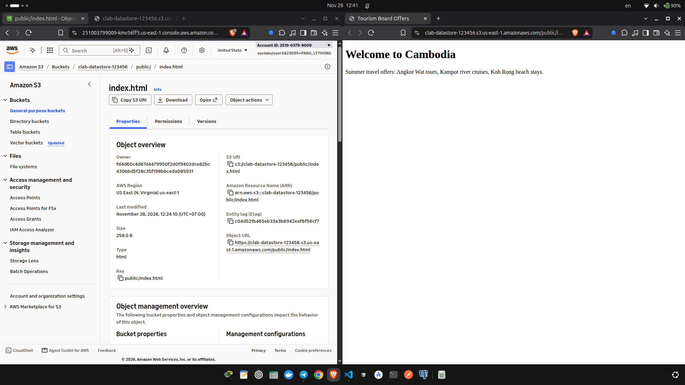
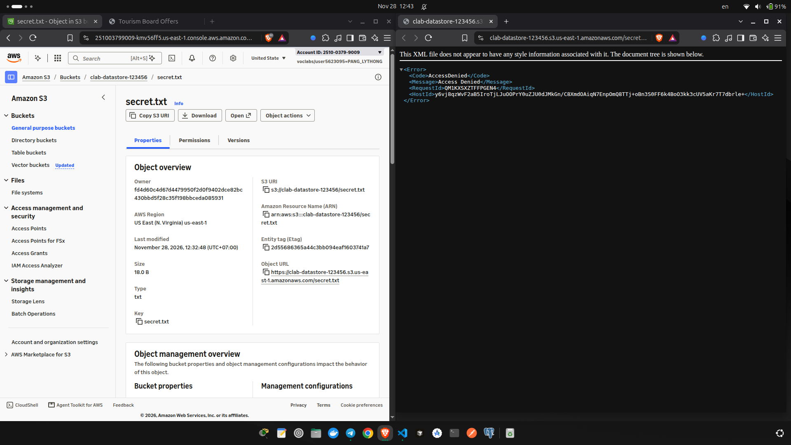
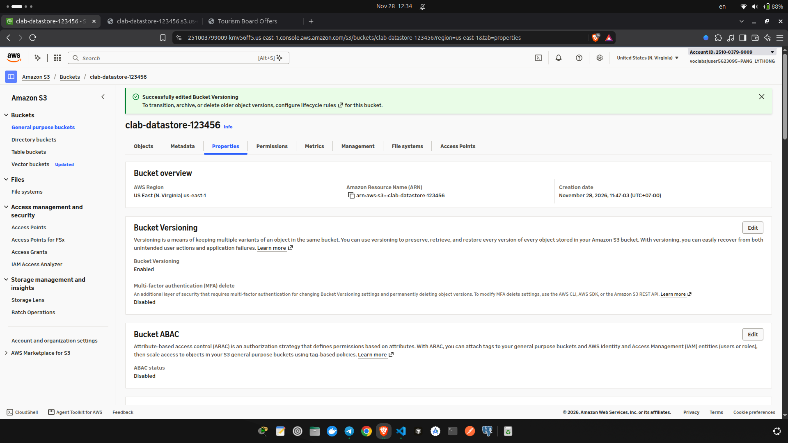
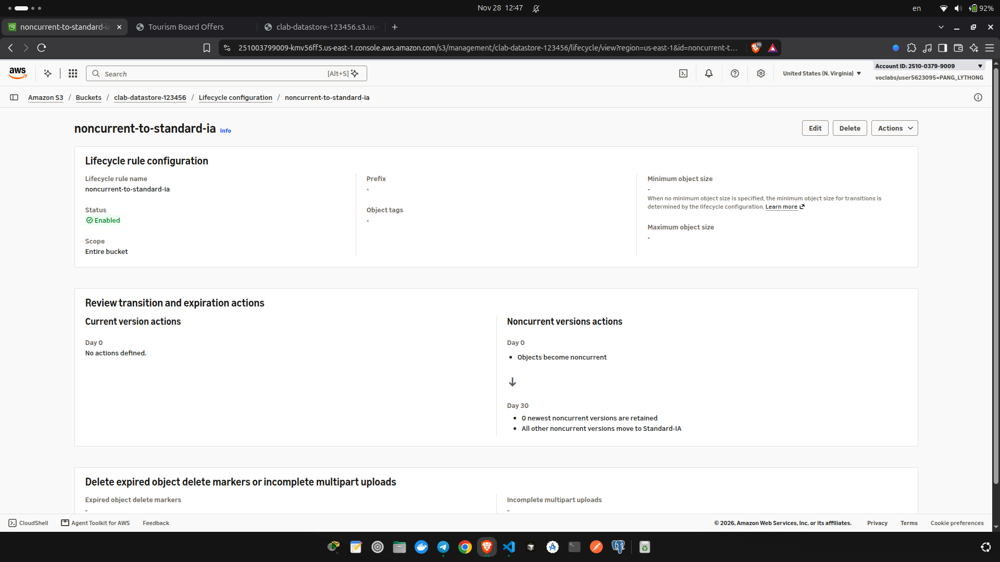

# Cloud Lab 3 Challenge Submission — Secure S3 Bucket

This challenge configures an Amazon S3 bucket so that only travel offers in the `public/` prefix are publicly readable. Objects outside that prefix remain private, previous object versions are retained, and older noncurrent versions transition to S3 Standard-IA.

- **Student name:** PANG Lythong
- **Student ID:** e20220161
- **Learner Lab username:** PANG_LYTHONG
- **AWS Region:** `us-east-1`
- **Bucket name:** `clab-datastore-123456`
- **Date completed:** 28 November 2026

## 1. Bucket

The bucket `clab-datastore-123456` was created in US East (N. Virginia), `us-east-1`.



## 2. Object ownership

Object Ownership is set to **Bucket owner preferred**, and ACLs are enabled. This keeps ownership control with the bucket owner while allowing the required ACL-based access configuration.



## 3. Public access policy

The bucket policy allows anonymous `s3:GetObject` access only to objects under the `public/` prefix. The relevant restriction is:

```json
"Resource": "arn:aws:s3:::clab-datastore-123456/public/*"
```

The complete policy is saved in [bucket-policy.json](bucket-policy.json).



### Public object

The `public/index.html` object is accessible through its S3 object URL and displays the tourism-board page.



### Private object

The root-level `secret.txt` object is outside the `public/` prefix. Its object URL returns `AccessDenied`, confirming that the policy does not expose objects at the bucket root.



## 4. Versioning

Bucket Versioning is enabled. When an existing object is overwritten, S3 keeps the previous version as a noncurrent version instead of permanently losing it.



## 5. Lifecycle rule

The lifecycle rule `noncurrent-to-standard-ia` applies to the entire bucket. After an object version becomes noncurrent, it transitions to S3 Standard-IA after 30 days. The rule keeps older versions available for recovery while reducing their storage cost.



## Questions

1. **Why was it necessary to turn off parts of Block Public Access, and why are objects outside `public/` still safe?**

   A public bucket policy cannot grant anonymous reads while the relevant Block Public Access settings reject public policies. I disabled only the settings needed for this controlled test and then used a narrowly scoped policy. Objects outside `public/` remain safe because the policy resource ends with `/public/*`; it does not match the root-level `secret.txt` object or any other prefix.

2. **What is a noncurrent version?**

   A noncurrent version is an older version of an object that remains stored after a newer version replaces it. For example, if `public/index.html` is uploaded again after versioning is enabled, the previous page becomes noncurrent while the new upload becomes the current version.

3. **Why move noncurrent versions to S3 Standard-IA instead of deleting them?**

   Older versions may still be needed to recover from accidental changes, bad uploads, or deletion. Standard-IA reduces storage cost for data that is accessed less often while preserving the versions for recovery. Deleting them would save more storage cost but remove that recovery capability.

## AI note

One suggestion from an AI tool was to restrict the public-read policy resource to `arn:aws:s3:::clab-datastore-123456/public/*` instead of exposing the whole bucket. I checked the suggestion by inspecting the saved policy, opening `public/index.html` through its object URL, and opening the root-level `secret.txt` URL. The public page loaded successfully, while the root object returned `AccessDenied`, confirming that the policy scope was correct.

## Clean up

After the screenshots were taken, the bucket should be emptied, including all object versions and delete markers, and then deleted:

- [x] Delete all current and noncurrent object versions.
- [x] Delete the `clab-datastore-123456` bucket.

No secret values from `secret.txt` are included in this README.
