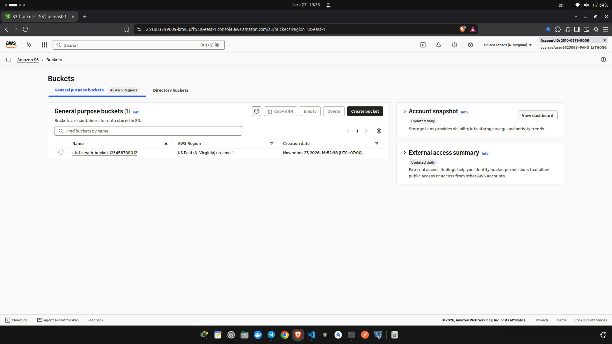
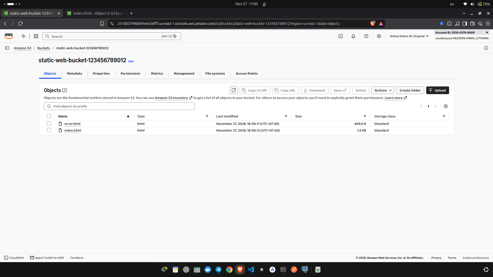
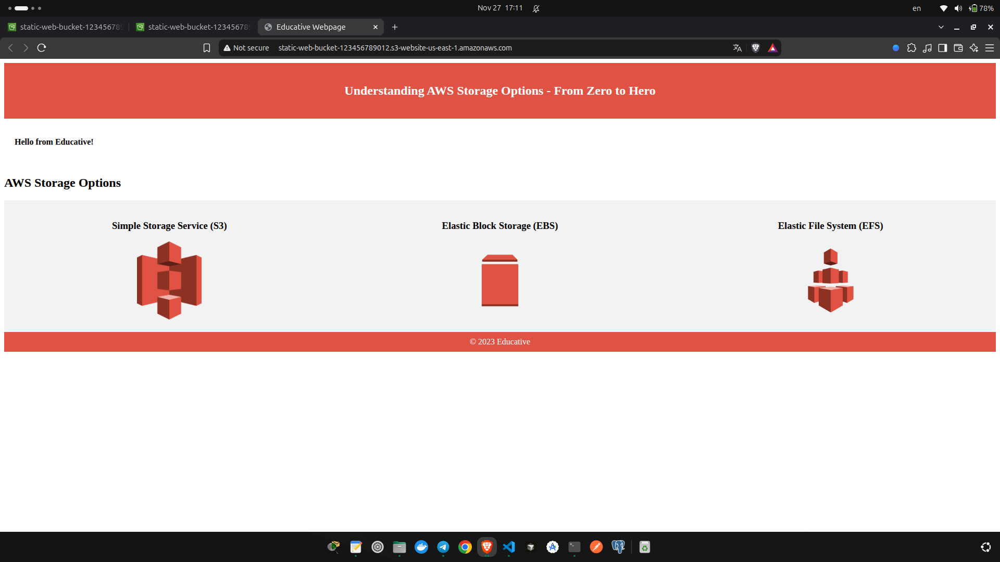
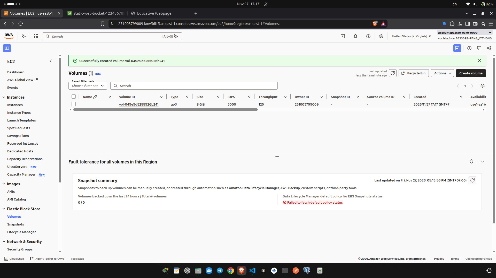
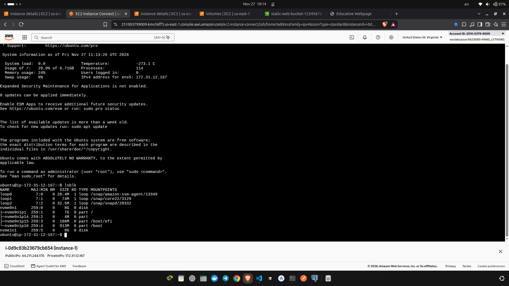
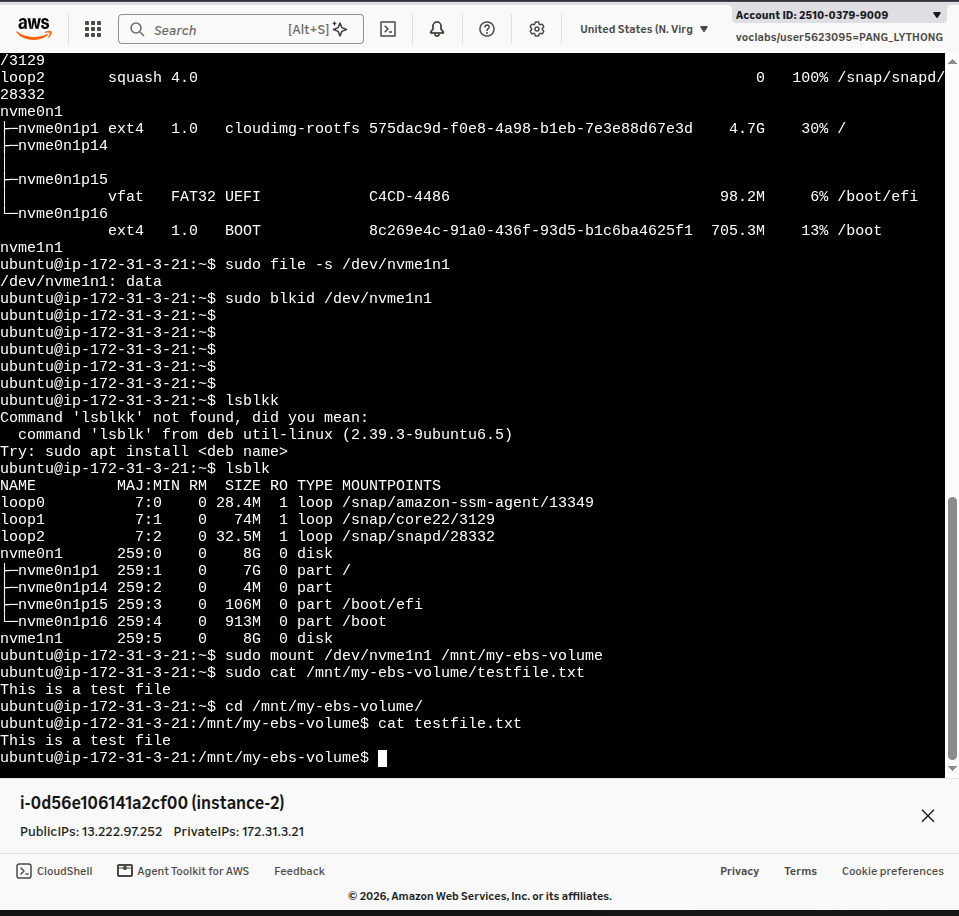
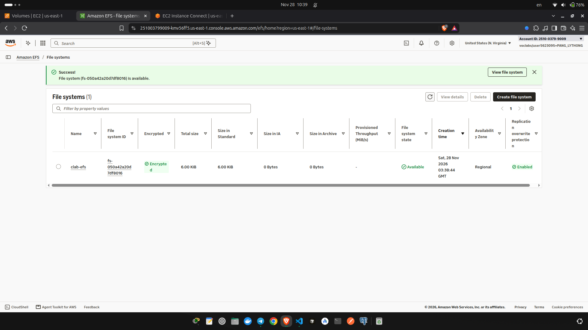
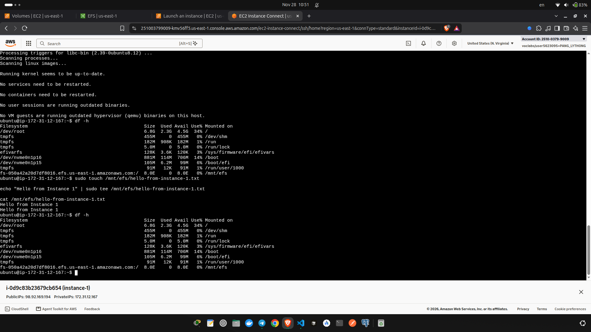
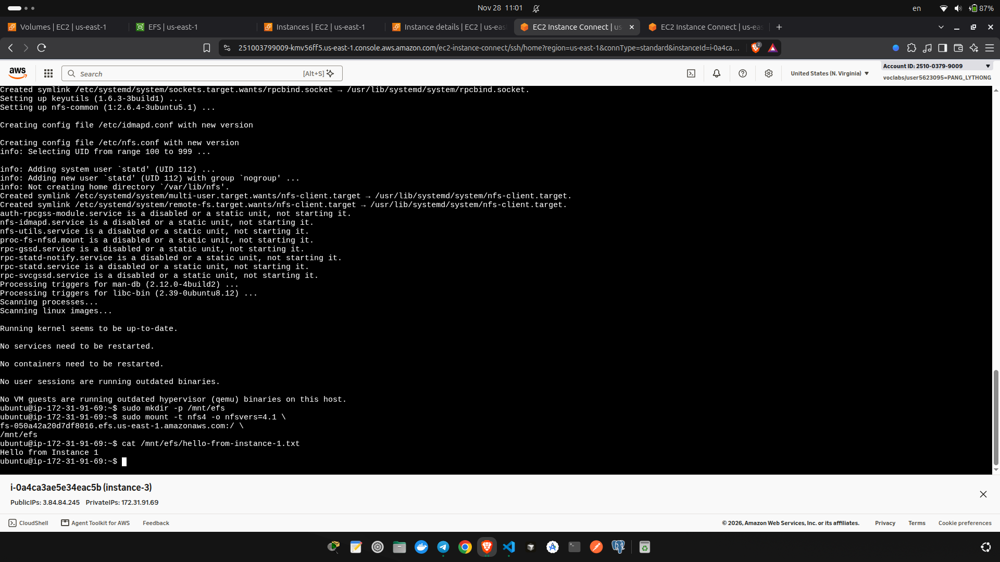

# Cloud Lab 3 Submission — AWS Storage Options

## Student information

- **Student name:** PANG Lythong
- **Student ID:** e20220161
- **Learner Lab username:** PANG_LYTHONG
- **Date completed:** 28 November 2026
- **AWS Region:** `us-east-1`

This lab compares Amazon S3, Amazon EBS, and Amazon EFS. I created an S3 static website, attached and moved an EBS volume between EC2 instances, and mounted an EFS file system from multiple instances.

## Part 2.1 — Amazon S3

### Bucket list

I created the bucket `static-web-bucket-123456789012` in the `us-east-1` region.

### Uploaded files

The bucket contains the website files `index.html` and `error.html`.

### Static website

After enabling static website hosting and applying the required bucket policy, the website endpoint served the uploaded page successfully.

## Part 2.2 — Amazon EBS

### Volumes page

I created an 8 GiB `gp3` EBS volume in the same Availability Zone as instance-1.

### Attached volume (`lsblk`)

On instance-1, the additional volume appeared as `/dev/nvme1n1`. I formatted it, mounted it, and created `testfile.txt` on the volume.

### File read on instance-2

After detaching the volume from instance-1 and attaching it to instance-2, it again appeared as `/dev/nvme1n1`. I mounted it at `/mnt/my-ebs-volume` and successfully read the existing `testfile.txt`.

## Part 2.3 — Amazon EFS

### File system and mount targets

I created the regional EFS file system `clab-efs`. It became available with mount targets for the VPC subnets.

### File created on instance-1

I mounted the EFS file system at `/mnt/efs` on instance-1 and created `hello-from-instance-1.txt` there.

### File listed on instance-3

I mounted the same EFS file system on instance-3 and read the file created by instance-1, confirming that EFS provides shared network storage.

## Questions

1. **Why did the S3 website initially return `403 Forbidden`?**

   Static website hosting only provides the website endpoint; it does not automatically grant public read access to objects. The request returned `403` because the bucket or its objects were not yet allowed to be read publicly. After the public-access setting and bucket policy allowed `s3:GetObject` for the website objects, the endpoint could return `index.html`.

2. **What would happen to a file saved on instance-1's root volume after terminating instance-1?**

   A file stored on the root volume would normally be lost when the instance is terminated because the root EBS volume is usually configured with `DeleteOnTermination`. Data that must survive termination should be stored on a separate EBS volume, EFS, or S3.

3. **Why did I run `mkfs` on instance-1 but not on instance-2?**

   The new EBS volume had no filesystem, so it had to be formatted before first use. After formatting and writing data, the filesystem remained on the volume. Instance-2 only needed to mount that existing filesystem; running `mkfs` there would format the volume again and destroy the stored data.

4. **Why could instance-1 and instance-3 use EFS at the same time?**

   EFS is shared network storage, so multiple EC2 instances can mount the same file system concurrently. EBS is block storage and normally must be detached before it is attached to another instance. The EFS mount targets provide network endpoints in the VPC subnets, and the instances need network connectivity and security-group access for NFS traffic on port 2049.

5. **Which service is best for each need?**

   - **A website's images:** S3, because it is durable object storage and can serve objects without attaching a disk to a server.
   - **The disk of a database server:** EBS, because it provides persistent block storage with predictable attachment to an EC2 instance.
   - **A folder shared by several web servers:** EFS, because multiple instances can mount and use the same file system at the same time.

## Problems and how I solved them

- The S3 website initially returned `403 Forbidden`; I resolved this by configuring the bucket policy for public object reads required by the static website.
- The EBS device name was presented by Ubuntu as `/dev/nvme1n1`, so I used the device name shown by `lsblk` when mounting it.
- Before mounting EFS, I installed the NFS client and mounted the file system through its regional mount target.

## Clean up

Before submitting or leaving the lab, verify that the temporary AWS resources have been removed:

- [ ] EC2 instances terminated.
- [ ] `clab-efs` deleted.
- [ ] Backup EBS volume deleted.
- [ ] Security groups created for the lab deleted when no longer needed.
- [ ] S3 bucket emptied and deleted.

The repository contains only the lab evidence and local web files. No AWS credentials, public IP addresses, or private key contents are included in this README.
