# Cloud Lab 4: Amazon VPC

## Student Information

- **Student name:** PANG Lythong
- **Student ID:** e20220161
- **Learner Lab user name:** `Amazon VPC with Public and Private Subnets`
- **Date completed:** `November 07 2026`

## Lab Summary

In this lab, I created an Amazon VPC with public and private subnets, configured internet access through an Internet Gateway and NAT Gateway, launched EC2 instances, and tested private-instance connectivity using AWS Systems Manager.

## Submission

This submission includes:

- `README.md`: Lab information, questions, and answers.
- `images/`: 11 screenshots showing the configurations and tests.

The lab follows the [Lab 4 instructions](https://github.com/RathpiseyAlpha/ITC-I5GIC-CC/blob/main/labs/lab4/lab4-instruction.md).

## Folder Structure

```text
cc-lab-e20220161/
└── lab4/
    ├── README.md
    └── images/
        ├── 01-vpc.png
        ├── 02-internet-gateway.png
        ├── 03-public-subnet.png
        ├── 04-public-route-table.png
        ├── 05-ec2-public.png
        ├── 06-test-public.png
        ├── 07-private-subnet.png
        ├── 08-nat-gateway.png
        ├── 09-private-route-table.png
        ├── 10-ec2-private.png
        └── 11-test-private.png
```

## Questions and Answers

### 1. The VPC is `10.0.0.0/24` and the subnets are `10.0.0.0/25` and `10.0.0.128/25`. How many IP addresses does each block contain, and why do the two subnets not overlap?

The VPC has `2^(32-24) = 256` total IPv4 addresses. Each `/25` subnet has `2^(32-25) = 128` total addresses. In AWS, five addresses in each subnet are reserved, leaving **123 usable IPv4 addresses** for resources.

The first subnet covers `10.0.0.0` through `10.0.0.127`, while the second covers `10.0.0.128` through `10.0.0.255`. They do not overlap because their address ranges are separate and the `/25` prefix divides the `/24` VPC into two equal blocks.

### 2. Both subnets are in the same VPC. What exactly makes `lab4-public-subnet` public and `lab4-private-subnet` private?

The route table association makes the difference. `lab4-public-subnet` is public because its route table has a default route (`0.0.0.0/0`) to an Internet Gateway. Resources in that subnet can use public IPv4 addresses to communicate with the internet.

`lab4-private-subnet` is private because it does not have a direct route to the Internet Gateway. Its default route points to a NAT Gateway instead, allowing outbound internet access without making the instances directly reachable from the internet. A subnet is not public merely because it belongs to a VPC or has a public-looking IP range.

### 3. Why is the NAT gateway placed in the **public** subnet and not in the private one?

The NAT Gateway must be in a public subnet so that it can use an Elastic IP address and send traffic to the Internet Gateway. Private instances send their internet-bound traffic to the NAT Gateway; the NAT Gateway translates their private source addresses and forwards the traffic through the Internet Gateway. If the NAT Gateway were placed in the private subnet, it would not have the required direct route to the Internet Gateway.

### 4. `lab4-ec2-02` has no public IP address. Can someone on the internet open a connection to it? Can it download updates? Explain both answers.

No, someone on the internet cannot directly open a connection to `lab4-ec2-02` because it has no public IP address and the private subnet has no direct route from the Internet Gateway. It could still be reached through an approved internal path, such as Systems Manager, a bastion host, a VPN, or a load balancer.

Yes, it can download updates if the private subnet's route table sends internet-bound traffic to the NAT Gateway. The NAT Gateway permits outbound connections and the returning response traffic, but it does not allow unsolicited inbound connections from the internet.

### 5. You tested internet access with Systems Manager instead of SSH. Why did the instances need `LabInstanceProfile` for this?

`LabInstanceProfile` supplies an IAM role to the EC2 instances. The role gives the Systems Manager Agent permission to register the instance as a managed node and communicate with Systems Manager, including sending command output and receiving commands. It commonly includes permissions from `AmazonSSMManagedInstanceCore`.

SSH would require an inbound port 22 rule, a reachable network path, and an SSH key or other login method. Systems Manager uses the instance role and the SSM Agent instead, so no public IP address or inbound SSH access is required. The instance still needs outbound connectivity through the NAT Gateway or suitable VPC endpoints to reach the Systems Manager services.

## Screenshots

The following screenshots were taken during the lab:

### 1. VPC (`lab4-vpc`)

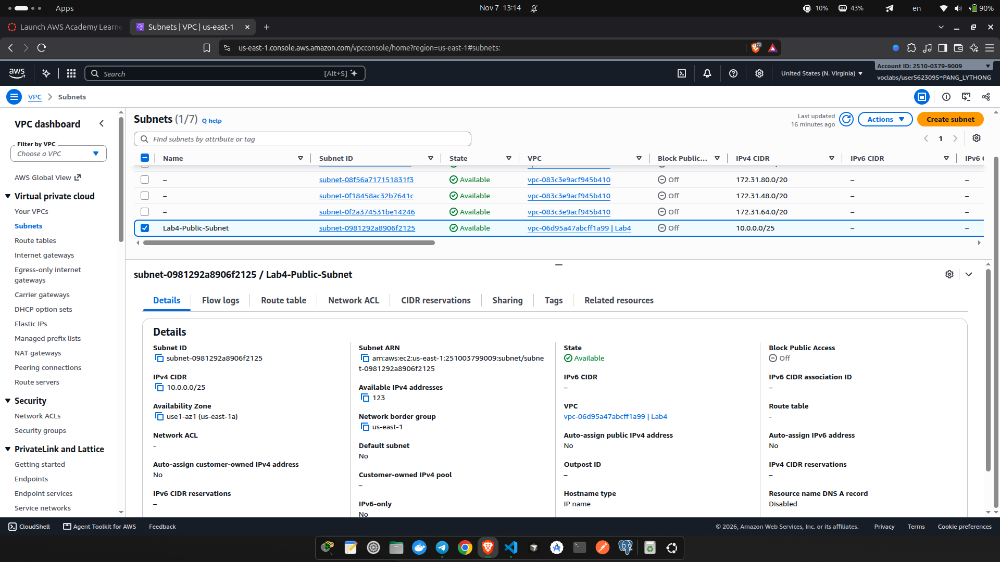

### 2. Internet Gateway Attached (`lab4-internet-gateway`)

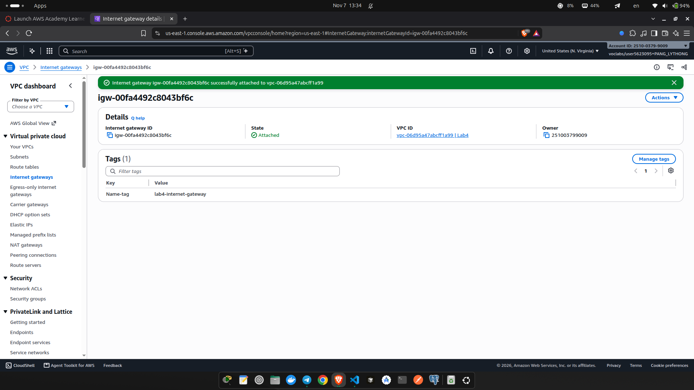

### 3. Public Subnet (`lab4-public-subnet`)

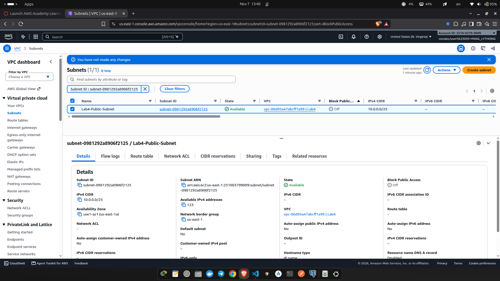

### 4. Public Route Table

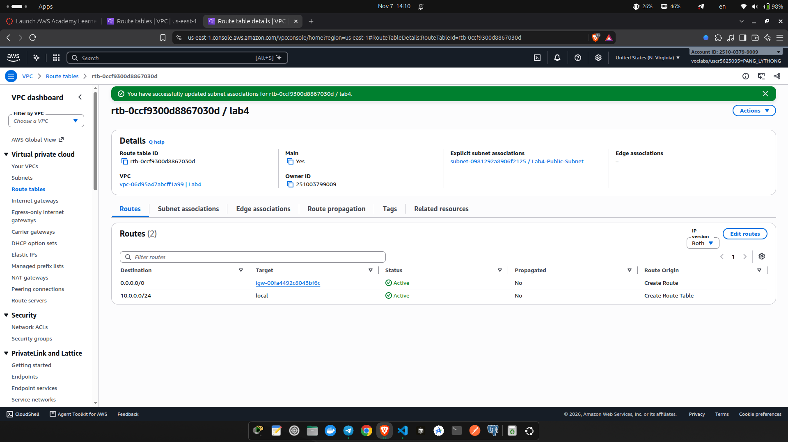

### 5. EC2 Instance in Public Subnet (`lab4-ec2-01`)

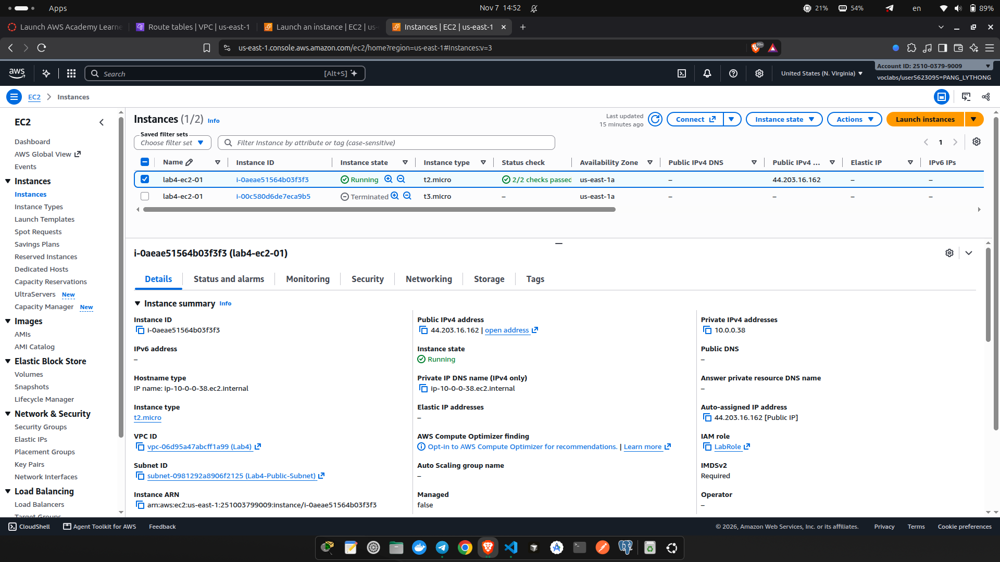

### 6. Internet Test from Public Subnet

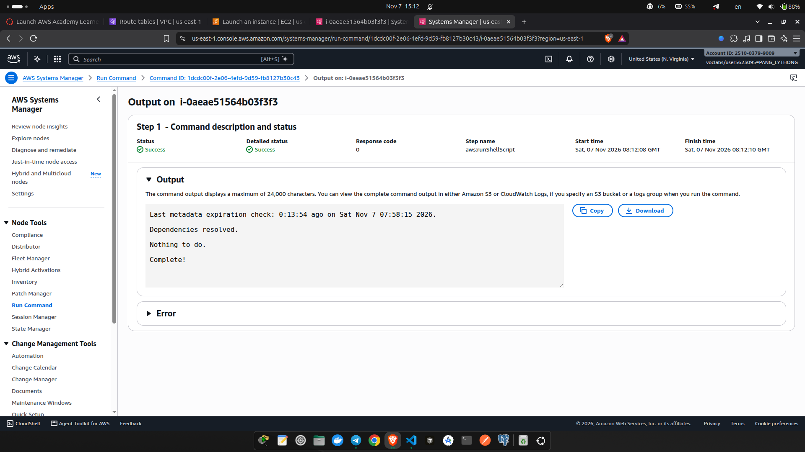

### 7. Private Subnet (`lab4-private-subnet`)

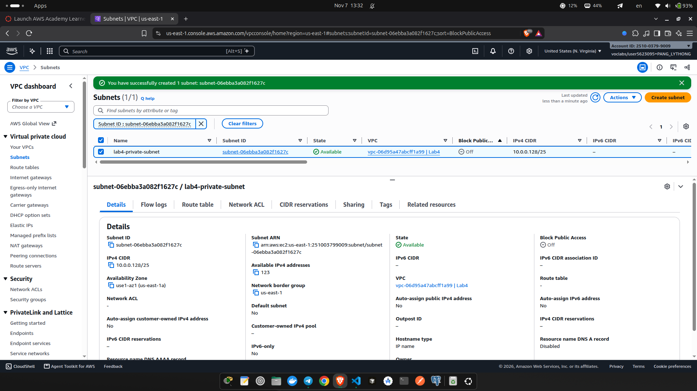

### 8. NAT Gateway (`lab4-nat-gateway`)

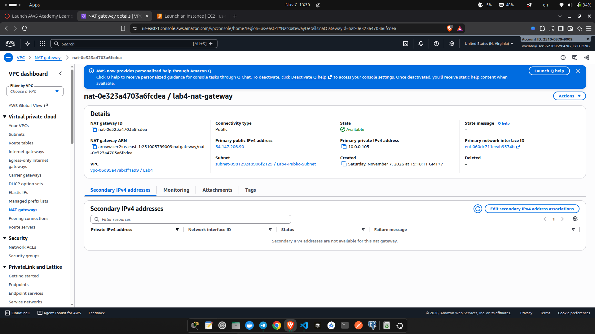

### 9. Private Route Table (`lab4-custom-route-table`)

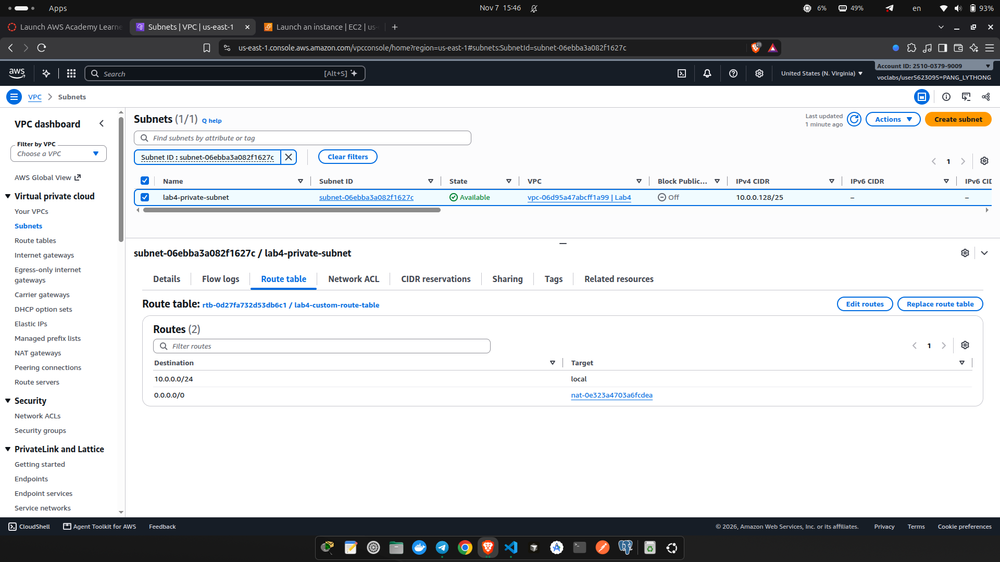

### 10. EC2 Instance in Private Subnet (`lab4-ec2-02`)

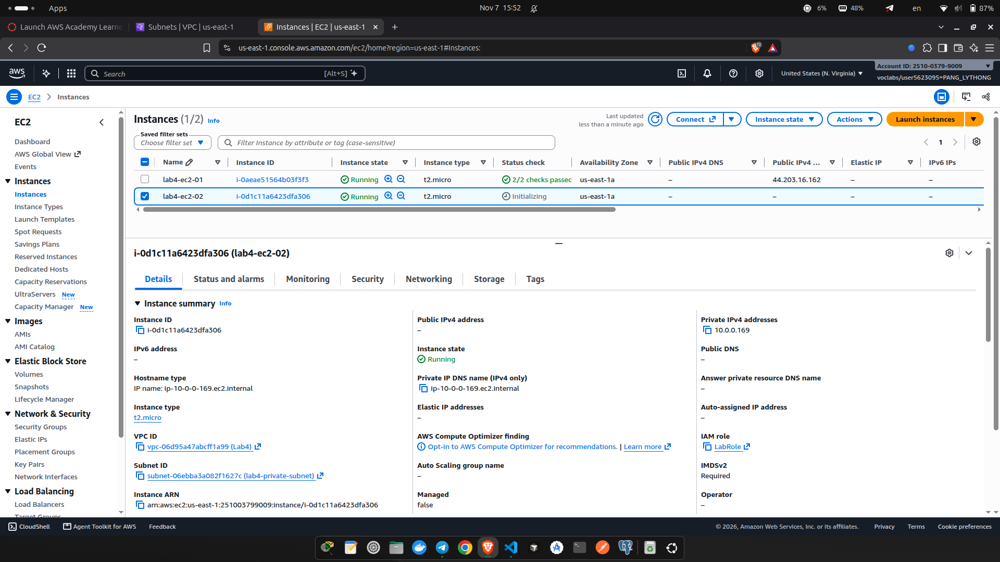

### 11. Internet Test from Private Subnet

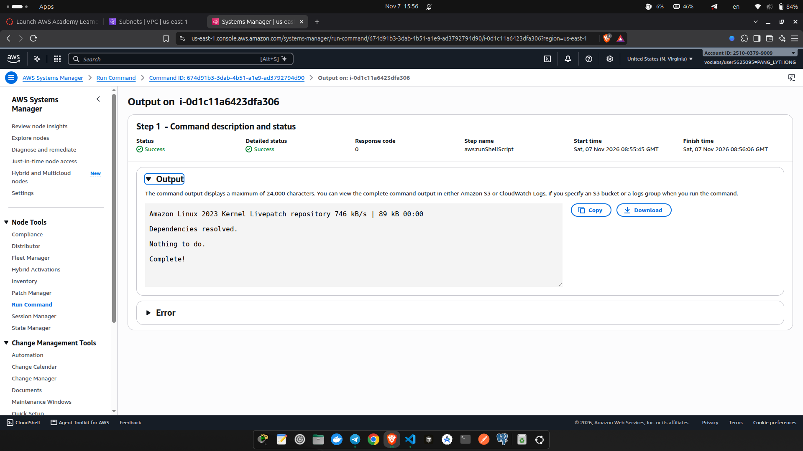

The following screenshots were taken during the lab:

### 1. VPC (`lab4-vpc`)


### 2. Internet Gateway Attached (`lab4-internet-gateway`)


### 3. Public Subnet (`lab4-public-subnet`)


### 4. Public Route Table


### 5. EC2 Instance in Public Subnet (`lab4-ec2-01`)


### 6. Internet Test from Public Subnet


### 7. Private Subnet (`lab4-private-subnet`)


### 8. NAT Gateway (`lab4-nat-gateway`)


### 9. Private Route Table (`lab4-custom-route-table`)


### 10. EC2 Instance in Private Subnet (`lab4-ec2-02`)


### 11. Internet Test from Private Subnet


