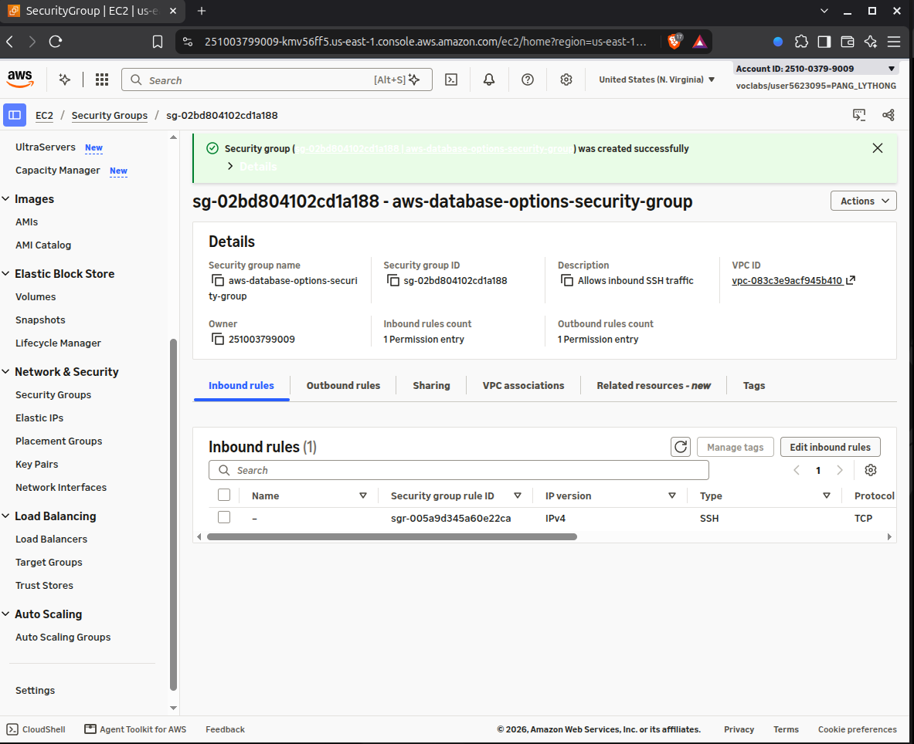
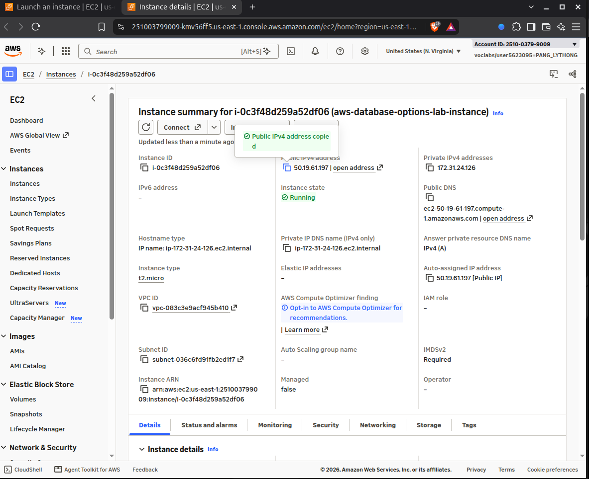
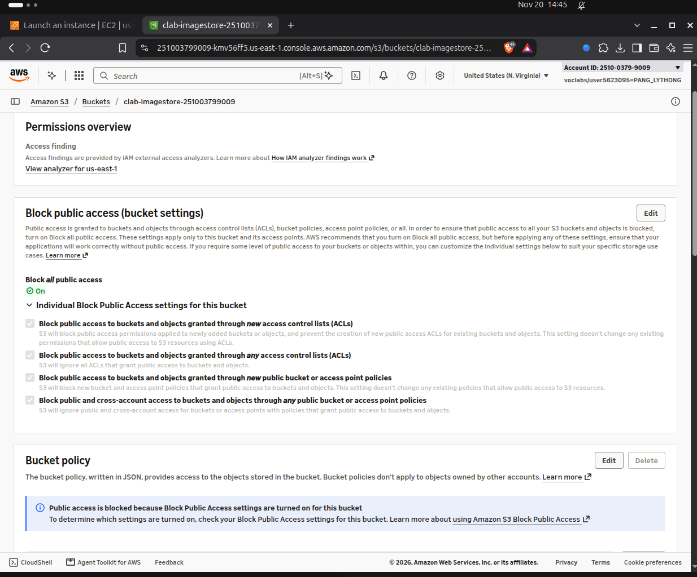
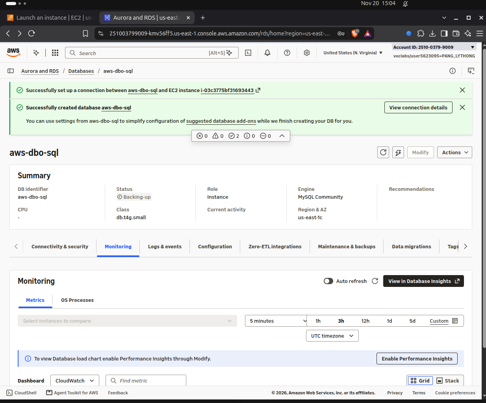
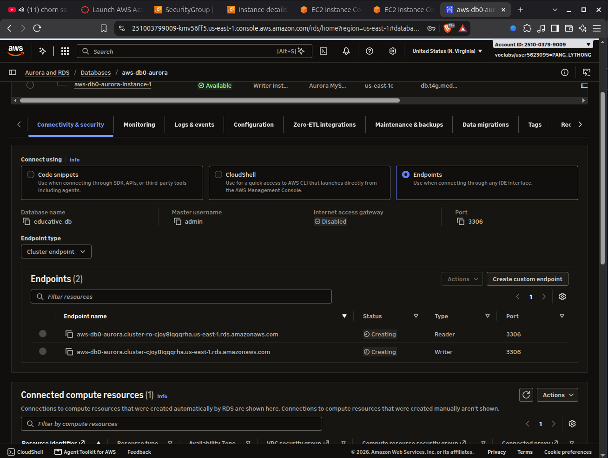
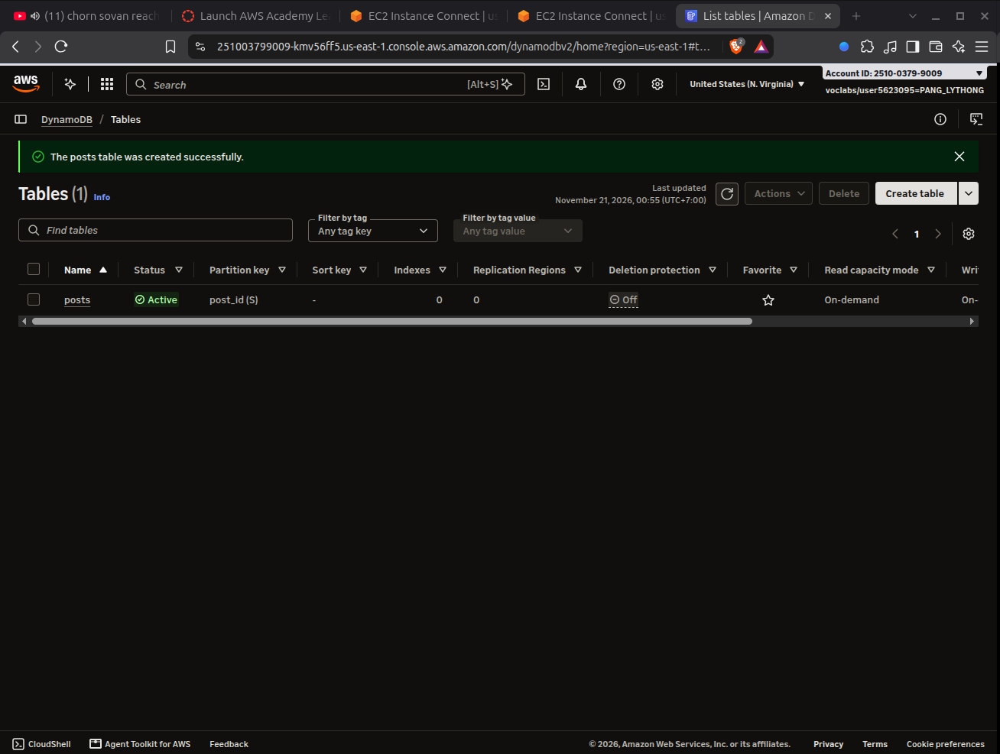
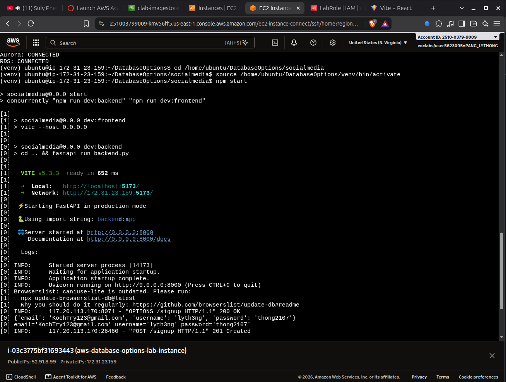
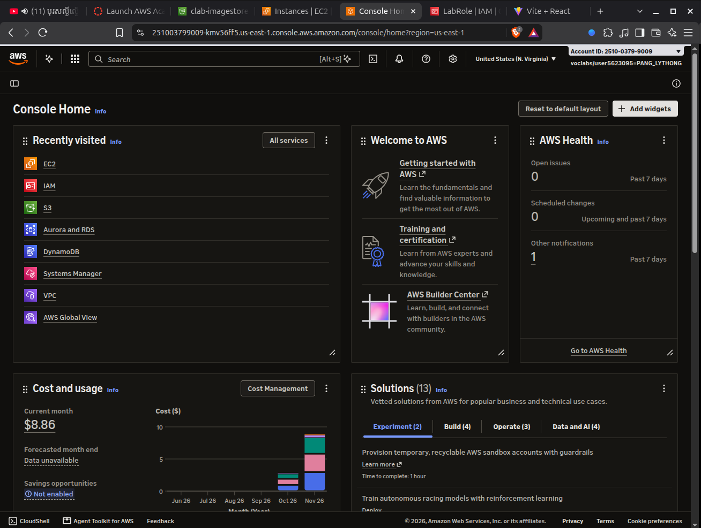

# Cloud Lab 5: AWS Database Services

## Student Information

- **Student name:** PANG Lythong
- **Student ID:** e20220161
- **Learner Lab :** `AWS Database Lab`
- **Date completed:** 21 November 2026

## Lab Summary

In this lab, I deployed a social media application on an Ubuntu EC2 instance and connected it to several AWS database and storage services. The application used Aurora MySQL for user information, Amazon RDS MySQL for post metadata, DynamoDB for post details, and Amazon S3 for uploaded media files.

## Submission

This submission includes:

- `README.md`: Lab information, deployment summary, and screenshot evidence.
- `images/`: Screenshots required by the lab instructions.

The lab was completed in the `us-east-1` region using the following resources:

- Security group: `aws-database-options-security-group`
- EC2 instance: `aws-database-options-lab-instance`
- S3 bucket: `clab-imagestore-<unique-suffix>`
- RDS MySQL instance: `aws-dbo-sql`
- Aurora MySQL cluster: `aws-dbo-aurora`
- DynamoDB table: `posts`

## Application and Database Design

The deployed application used the following data flow:

```text
EC2 frontend and FastAPI backend
├── Aurora MySQL: users
├── RDS MySQL: user_post metadata
├── DynamoDB: posts and post content
└── S3: uploaded media files
```

The application supported user signup, user login, post creation, optional media uploads, and displaying posts.

## Important Security Note

Passwords, AWS access keys, secret keys, session tokens, database endpoints containing sensitive information, and private key files are not included in this README or the screenshots. The `.pem` file should not be committed to GitHub.

## Screenshot Evidence

### 1. Security Group Creation

The security group allows SSH on port 22 and application traffic on ports 8000 and 5173.



### 2. EC2 Instance Launch

The EC2 instance `aws-database-options-lab-instance` is running with the required security group attached.



### 3. S3 Bucket Creation

The S3 bucket stores media files uploaded by the social media application.



### 4. RDS DB Instance Creation

The RDS MySQL instance `aws-dbo-sql` is available and provides the SQL database for post metadata.



### 5. Aurora DB Instance Creation

The Aurora MySQL cluster `aws-dbo-aurora` is available with its database endpoint.



### 6. DynamoDB Table Creation

The DynamoDB table `posts` is active and uses `post_id` as its partition key.



### 7. Application Configuration and Testing

The application was configured with the database services and tested through the EC2 public address on port 5173.



### 8. Final Infrastructure

The final infrastructure includes the EC2 instance, security group, S3 bucket, RDS database, Aurora database, and DynamoDB table.


### 9. Final infrastructure

The final infrastructure includes the EC2 instance, security group, S3 bucket, RDS database, Aurora database, and DynamoDB table.



### 10. Signup and post creation


